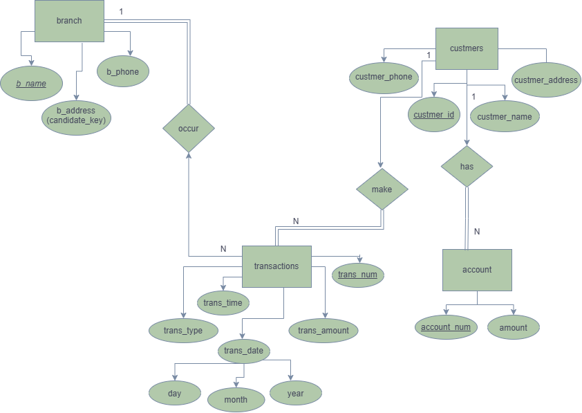
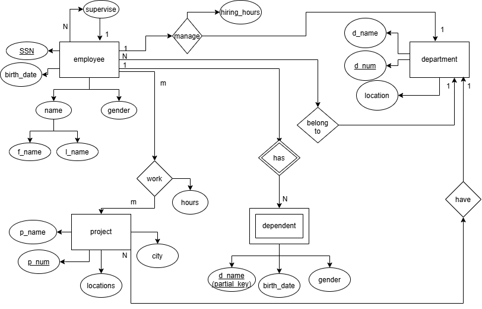
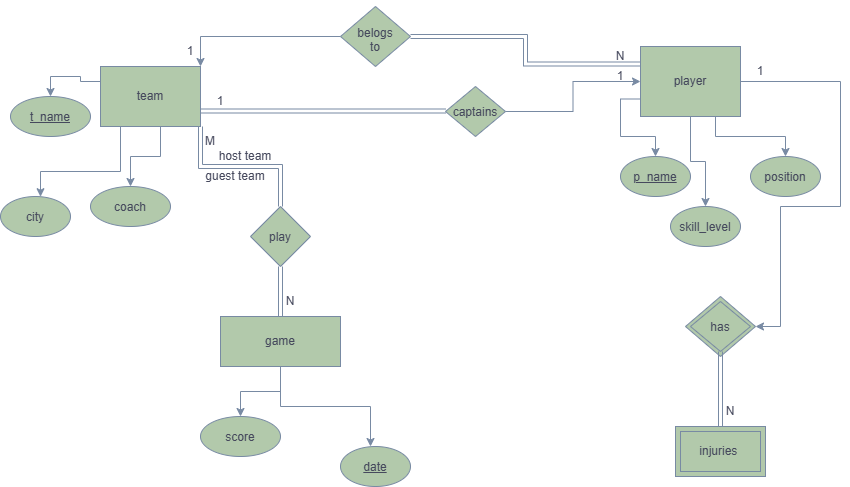

# Database Design Portfolio: Entity-Relationship Models

A collection of four Entity-Relationship (ER) designs in Chen notation, each with its business scenario, entity and relationship analysis, constraints, and a normalization/design audit. The final project (a **Freelancing Platform**) is a larger, real-world-scale system.

| # | Project | Domain | Complexity |
|---|---------|--------|------------|
| 1 | [Banking System](#project-1--banking-system) | Finance | Basic |
| 2 | [Company Management](#project-2--company-management-system) | HR / Operations | Intermediate (weak entity, recursion, M:N) |
| 3 | [NHL Hockey League](#project-3--nhl-hockey-league) | Sports | Intermediate (roles, weak entity, 1:1) |
| 4 | [**My Project: Freelancing Platform**](#project-4--freelancing-platform-my-project) | Marketplace / FinTech | Advanced (17 relationships, 13 entities) |

## Repository Structure

```
.
├── README.md
└── images/
    ├── project1_banking.png
    ├── project2_company.png
    ├── project3_nhl.png
    └── my_project.jpg
```

> **Notation legend (Chen):** rectangle = entity; double rectangle = weak entity; ellipse = attribute; underlined = primary key; dashed underline = partial key; diamond = relationship; double diamond = identifying relationship; **double line = total participation**, single line = partial participation.

---

# Project 1: Banking System



## Business Scenario
A banking database controls withdrawal and deposit transactions made by customers. The bank has many branches, each with a unique name, unique address and a phone. Customers have a unique ID, name, address and phones. Each customer holds one account identified by a unique account number, with an amount (balance), and the system tracks the last transaction time and date (day, month, year). A customer can perform a withdrawal or deposit at any branch. Each transaction records a number, type, date, amount and time, plus the branch where it occurred.

## Entities and Attributes

| Entity | Primary Key | Other Attributes | Notes |
|---|---|---|---|
| **BRANCH** | `b_name` | `b_address` (candidate key), `b_phone` | Two keys: name and address are both unique |
| **CUSTOMER** | `customer_id` | `name`, `address`, `phone` | |
| **ACCOUNT** | `account_num` | `amount` | |
| **TRANSACTION** | `trans_num` | `trans_type`, `trans_amount`, `trans_time`, `trans_date` (composite: day, month, year) | Composite attribute `trans_date` |

## Relationships and Cardinalities

| Relationship | Entities | Cardinality | Participation (from diagram) |
|---|---|---|---|
| **make** | CUSTOMER → TRANSACTION | 1 : N | TRANSACTION total, CUSTOMER partial |
| **occur** | BRANCH → TRANSACTION | 1 : N | BRANCH total (double line), TRANSACTION partial as drawn |
| **has** | CUSTOMER → ACCOUNT | drawn as 1 : N | ACCOUNT total |

## Schema Audit

| # | Finding | Severity | Recommendation |
|---|---------|----------|----------------|
| 1 | The scenario says *each customer has one account*, but **has** is drawn **1 : N**. | Cardinality mismatch | Make it **1 : 1** (or state the assumption that a customer may hold several accounts, and then fix the scenario). |
| 2 | `trans_time` and `last transaction date` belong to ACCOUNT per the scenario but are modelled only on TRANSACTION. | Semantic mismatch | "Last transaction" is *derived* (`MAX(trans_date, trans_time)`); keep it on TRANSACTION and compute it, so no redundancy is stored. |
| 3 | TRANSACTION is linked to CUSTOMER but **not to ACCOUNT**, yet transactions change an account's balance. | Missing link | Add **ACCOUNT 1 : N TRANSACTION**; the customer is then reachable through the account. |
| 4 | The scenario mentions *loan* transactions, but only withdrawal/deposit are defined. | Scope gap | State the assumption that `trans_type ∈ {Withdrawal, Deposit}`; add a LOAN entity if required. |
| 5 | `custmer_*` spelling in attribute names. | Naming | Rename to `customer_*`. |
| 6 | `phone` is single-valued, but "phones" is plural for customers. | Multivalued attribute | Draw `customer_phone` as a **multivalued** (double ellipse) attribute → separate table `CUSTOMER_PHONE(customer_id, phone)` for 1NF. |
| 7 | Participation is inconsistent: `occur` shows a double line on BRANCH (every branch must have transactions). | Constraint | A new branch has no transactions yet, so BRANCH should be **partial**; TRANSACTION should be **total** (a transaction must occur at a branch). |

## Design Decisions and Normalization (3NF)
- Composite `trans_date` is flattened into `trans_day, trans_month, trans_year` (or a single `DATE`) in the relational mapping.
- Multivalued customer phones are moved to their own table to satisfy 1NF.
- Every non-key attribute depends on the whole key and nothing but the key. The only 3NF-risk is storing `last_transaction_date` on ACCOUNT, which is why it is derived.
- The 1:N relationships are mapped through foreign keys on the N side: `TRANSACTION(customer_id, branch_name, account_num)`.

---

# Project 2: Company Management System



## Business Scenario
A company has employees, each with an SSN, birth date, gender and a name composed of first and last name. The company has departments, each with a name, a unique number and locations. Employees work on several projects; each project has a name, a number (identifier), a location and a city. An employee may have dependents (unique dependent name, gender, birth date); if an employee leaves, his dependents' data need not be stored. Every department has exactly one employee managing it, with a hiring date. A department may have employees, but each employee works in only one department. A department may control several projects and each project is assigned to exactly one department. Employees work on several projects and projects have several employees, with working hours recorded per employee per project. Each employee has a supervisor.

## Entities and Attributes

| Entity | Primary Key | Other Attributes | Type |
|---|---|---|---|
| **EMPLOYEE** | `SSN` | `birth_date`, `gender`, `name` (composite: `f_name`, `l_name`) | Strong |
| **DEPARTMENT** | `d_num` | `d_name`, `location` | Strong |
| **PROJECT** | `p_num` | `p_name`, `locations`, `city` | Strong |
| **DEPENDENT** | `d_name` (partial key) | `birth_date`, `gender` | **Weak**, owned by EMPLOYEE |

## Relationships and Cardinalities

| Relationship | Entities | Cardinality | Attributes | Participation |
|---|---|---|---|---|
| **supervise** (recursive) | EMPLOYEE (supervisor) → EMPLOYEE (supervisee) | 1 : N | none | Supervisor partial (top boss has none) |
| **manage** | EMPLOYEE → DEPARTMENT | 1 : 1 | `hiring_hours` (see audit) | DEPARTMENT **total**, EMPLOYEE partial |
| **belong to** | EMPLOYEE → DEPARTMENT | N : 1 | none | EMPLOYEE **total**, DEPARTMENT partial |
| **work** | EMPLOYEE ↔ PROJECT | **M : N** | `hours` | Both total/partial per business rules |
| **have** | DEPARTMENT → PROJECT | 1 : N | none | PROJECT **total**, DEPARTMENT partial |
| **has** (identifying) | EMPLOYEE → DEPENDENT | 1 : N | none | DEPENDENT **total** (weak entity) |

## Schema Audit

| # | Finding | Severity | Recommendation |
|---|---------|----------|----------------|
| 1 | `manage` carries **`hiring_hours`**, but the scenario requires a **hiring date**. | Attribute mismatch | Rename to `hiring_date` (or `start_date`). |
| 2 | DEPARTMENT `location` is drawn single-valued, but the scenario says *locations* (a set). | 1NF violation | Make it **multivalued** (double ellipse) → `DEPT_LOCATIONS(d_num, location)`. |
| 3 | The diagram has no double lines on the non-weak relationships, but the scenario states mandatory rules (a department always has a manager; an employee must work in one department; a project must belong to one department). | Missing participation constraints | Add double lines: DEPARTMENT–manage, EMPLOYEE–belong to, PROJECT–have. |
| 4 | Weak entity DEPENDENT is correctly modelled with a double rectangle, a partial key and an identifying relationship. | Valid | Map with `ON DELETE CASCADE`: this implements the rule "if the employee left, no need to store dependents". |
| 5 | `manage` (1:1) and `belong to` (N:1) both connect EMPLOYEE and DEPARTMENT. | Valid, but check | A manager must also belong to the department they manage, which is not expressible in ER and needs a CHECK/trigger. |
| 6 | PROJECT has both `locations` and `city`. | Redundancy risk | If `location` determines `city`, it is a transitive dependency (3NF violation); keep both only if they are independent. |
| 7 | `name` is composite (`f_name`, `l_name`). | Valid | Flatten into two columns during mapping. |

## Design Decisions and Normalization (3NF)
- `hiring_date` depends on the manager–department pair, so it is stored on DEPARTMENT (1:1 mapping) as `mgr_ssn, mgr_start_date`.
- The recursive relationship becomes `EMPLOYEE.super_ssn → EMPLOYEE.SSN`.
- The M:N `work` relationship becomes the table `WORKS_ON(ssn, p_num, hours)` with composite PK.
- The weak entity becomes `DEPENDENT(ssn, d_name, gender, birth_date)` with composite PK `(ssn, d_name)`.

---

# Project 3: NHL Hockey League



## Business Scenario
The National Hockey League has many teams. Each team has a name, a city, a coach, a captain and a set of players. Each player belongs to only one team, and has a name, a position (e.g. left wing, goalie), a skill level and a set of injury records. A team captain is also a player. A game is played between two teams (host team and guest team) and has a date and a score (e.g. 4 to 2).

## Entities and Attributes

| Entity | Primary Key | Other Attributes | Type |
|---|---|---|---|
| **TEAM** | `t_name` | `city`, `coach` | Strong |
| **PLAYER** | `p_name` | `position`, `skill_level` | Strong |
| **GAME** | `date` | `score` | Strong |
| **INJURY** | (partial, see audit) | none shown | **Weak**, owned by PLAYER |

## Relationships and Cardinalities

| Relationship | Entities | Cardinality | Participation | Roles |
|---|---|---|---|---|
| **belongs to** | TEAM → PLAYER | 1 : N | PLAYER **total**, TEAM **total** | none |
| **captains** | TEAM → PLAYER | **1 : 1** | TEAM **total** (every team has a captain), PLAYER partial | `captain` |
| **play** | TEAM ↔ GAME | M : N (two roles) | GAME **total** | `host_team`, `guest_team` |
| **has** (identifying) | PLAYER → INJURY | 1 : N | INJURY **total** | none |

## Assumptions
1. A player belongs to exactly one team (no trades history).
2. Each team has exactly one captain, and the captain belongs to that same team.
3. A game involves exactly two **different** teams: one host and one guest.
4. A player may have zero or more injury records.

## Schema Audit

| # | Finding | Severity | Recommendation |
|---|---------|----------|----------------|
| 1 | `p_name` is the PK of PLAYER; two players can share a name in a league. | Key weakness | Use a surrogate `player_id`, keeping `name` as a normal attribute. |
| 2 | `date` is the sole PK of GAME, but several games are played on the same day. | **Key error** | Use `game_id`, or the composite `(date, host_team, guest_team)`. |
| 3 | `play` is drawn as one relationship with two overlapping role lines. | Notation clarity | Draw two role-labelled lines (`host_team`, `guest_team`) on the same diamond, and add the constraint host ≠ guest. |
| 4 | INJURY is a weak entity but shows **no attributes or partial key**. | Incomplete | Add `injury_date` (partial key), `injury_type`, `severity`, `recovery_date`. |
| 5 | `score` is a single value ("4 to 2"). | 1NF / atomicity | Make it composite: `host_score`, `guest_score`. |
| 6 | "belogs to" typo on the relationship. | Naming | → `belongs to`. |
| 7 | A captain must be a player **of the same team** (cross-relationship rule). | Not expressible in ER | Enforce via a composite FK/trigger: `TEAM.captain_id` references a player whose `team_name` equals this team. |
| 8 | The cyclic dependency (TEAM ↔ PLAYER via `belongs to` and `captains`) | Mapping detail | `captains` becomes a nullable FK on TEAM (`captain_id`) to avoid a circular insert problem. |

## Design Decisions and Normalization (3NF)
- `belongs to` maps to `PLAYER.team_name` (FK on the N side).
- `play` maps to `GAME(game_id, game_date, host_team, guest_team, host_score, guest_score)`; both team columns are FKs to TEAM.
- INJURY maps to `INJURY(player_id, injury_date, ...)` with composite PK and `ON DELETE CASCADE`.
- All attributes are fully dependent on their keys; there are no transitive dependencies, so the design is in 3NF.

---

# Project 4: Freelancing Platform ("My Project")


## 4.1 Business Scenario and Problem Statement
*(Reverse-engineered from the ERD.)*

A **freelancing marketplace** connects **clients** who need work done with **freelancers** who offer their skills. The platform must manage identities, skills, project lifecycles, competitive bidding, secure milestone payments, communication, subscriptions and reputation.

**Users.** Every person on the platform is a **USER** with a unique `user_id`, full name, email, age, country, join date, account status (`user_status`) and a role (`user_type`: client or freelancer). Users are partially involved in most relationships: a user may never post, bid or message.

**Freelancer profiles and portfolios.** A user may have **at most one FREELANCER_PROFILE** (title, overview, hourly rate, success score and total earned), and every profile belongs to exactly one user. A profile showcases **one or more PORTFOLIO_ITEMS** (title, description, image URL, project URL); each portfolio item belongs to exactly one profile.

**Skills.** The platform keeps a catalogue of **SKILLS**. A user can have many skills and a skill can be held by many users (**M:N**), with the attribute `years_experience` recording experience per user–skill pair. Likewise, a project requires several skills and a skill can be required by many projects (**M:N**).

**Projects.** A client **posts** many projects. Each project has a title, status, budget, project type and posted date, is posted by exactly one user, and **belongs to exactly one CATEGORY** (a category groups many projects).

**Bidding.** Freelancers **submit BIDS** (amount, proposal text, execution days, creation time, acceptance flag). A user submits many bids; each bid is submitted by exactly one user and is **placed on exactly one project**; a project can receive many bids.

**Milestones and payments.** A project is divided into **PROJECT_MILESTONES** (title, due date, amount, status); each milestone belongs to exactly one project. Money moves through **TRANSACTIONS** (amount, platform fee, payment method, date). Each transaction is made by one user, is paid for one project, and pays one milestone. A milestone may be paid by several transactions (e.g. partial payments or refunds), and a project may have many transactions.

**Messaging.** Users **send MESSAGES** (body, sent time, read flag). Each message is sent by exactly one user and **discusses exactly one project**. A user sends many messages and a project has many messages.

**Subscriptions.** The platform offers **SUBSCRIPTION_PLANS** (name, monthly fee, monthly bid limit). Users **subscribe** through **USER_SUBSCRIPTIONS** (start date, status): one user can have many subscriptions over time, each plan **defines** many subscriptions, and each subscription belongs to exactly one user and one plan.

**Reviews and disputes.** After work is done, **REVIEWS_AND_DISPUTES** records are created (rating, text, creation date, dispute flag and dispute reason). Each record **involves** one user and **evaluates** one project. A user or project may have many such records.

### Problem Statement
Design a relational database for the platform that:
1. Stores users, freelancer profiles, portfolios and skills without redundancy.
2. Supports project posting, categorisation and skill requirements.
3. Records competitive bids and the accepted bid for each project.
4. Tracks milestone-based payments and platform fees.
5. Stores project-scoped communication.
6. Manages subscription tiers with bid limits.
7. Captures ratings and disputes for reputation and conflict resolution.

## 4.2 Entities, Attributes and Keys

| Entity | PK | Attributes | Type |
|---|---|---|---|
| **USERS** | `user_id` | `full_name`, `email`, `age`, `country`, `join_date`, `user_status`, `user_type` | Strong |
| **FREELANCER_PROFILES** | `profile_id` | `title`, `overview`, `hourly_rate`, `success_score`, `total_earned` | Strong (FK: `user_id`) |
| **PORTFOLIO_ITEMS** | `item_id` | `title`, `description`, `image_url`, `project_url` | Strong (FK: `profile_id`) |
| **SKILLS** | `skill_id` | `skill_name` | Strong |
| **PROJECTS** | `project_id` | `title`, `status`, `budget`, `project_type`, `posted_date` | Strong (FKs: `client_id`, `category_id`) |
| **CATEGORIES** | `category_id` | `category_name` | Strong |
| **BIDS** | `bid_id` | `bid_amount`, `proposal_text`, `execution_days`, `is_accepted`, `created_at` | Strong (FKs: `user_id`, `project_id`) |
| **PROJECT_MILESTONES** | `milestone_id` (dashed, partial key) | `title`, `due_date`, `amount`, `status` | Dependent on PROJECTS (see audit) |
| **TRANSACTIONS** | `transaction_id` | `amount`, `platform_fee`, `payment_method`, `transaction_date` | Strong (FKs: `user_id`, `project_id`, `milestone_id`) |
| **MESSAGES** | `message_id` | `message_body`, `sent_at`, `is_read` | Strong (FKs: `sender_id`, `project_id`) |
| **SUBSCRIPTION_PLANS** | `plan_id` | `plan_name`, `monthly_fee`, `bid_limit_per_month` | Strong |
| **USER_SUBSCRIPTIONS** | `subscription_id` | `start_date`, `status` | Associative (FKs: `user_id`, `plan_id`) |
| **REVIEWS_AND_DISPUTES** | `review_id` | `rating`, `review_text`, `is_disputed`, `dispute_reason`, `created_at` | Strong (FKs: `user_id`, `project_id`) |

## 4.3 Relationships, Cardinalities and Participation

| # | Relationship | Left entity | Right entity | Cardinality | Participation (as drawn) | Attributes |
|---|---|---|---|---|---|---|
| 1 | **Has_Profile** | USERS | FREELANCER_PROFILES | **1 : 1** | Profile **total**, user partial | none |
| 2 | **Contains** | FREELANCER_PROFILES | PORTFOLIO_ITEMS | **1 : N** | Portfolio item **total** | none |
| 3 | **Has_Skill** | USERS | SKILLS | **M : N** | partial both | `years_experience` |
| 4 | **Requires_Skill** | SKILLS | PROJECTS | **M : N** | Project **total** | none |
| 5 | **Posts_Project** | USERS | PROJECTS | **1 : N** | Project **total** | none |
| 6 | **Belongs_To** | CATEGORIES | PROJECTS | **1 : N** | Project **total** | none |
| 7 | **Submits_Bid** | USERS | BIDS | **1 : N** | Bid **total** | none |
| 8 | **Placed_On** | PROJECTS | BIDS | **1 : N** | Bid **total** | none |
| 9 | **Has_Milestones** | PROJECTS | PROJECT_MILESTONES | **1 : N** | Milestone **total** | none |
| 10 | **Makes** | USERS | TRANSACTIONS | **1 : N** | Transaction **total** | none |
| 11 | **Paid_For** | PROJECTS | TRANSACTIONS | **1 : N** | Transaction **total** | none |
| 12 | **Pays_Milestone** | PROJECT_MILESTONES | TRANSACTIONS | **1 : N** | Transaction **total** | none |
| 13 | **Sends** | USERS | MESSAGES | **1 : N** | Message **total** | none |
| 14 | **Discusses** | PROJECTS | MESSAGES | **1 : N** | Message **total** | none |
| 15 | **Subscribes_To** | USERS | USER_SUBSCRIPTIONS | **1 : N** | Subscription **total** | none |
| 16 | **Defines** | SUBSCRIPTION_PLANS | USER_SUBSCRIPTIONS | **1 : N** | Subscription **total** | none |
| 17 | **Involves** | USERS | REVIEWS_AND_DISPUTES | **1 : N** | Review **total** | none |
| 18 | **Evaluates** | PROJECTS | REVIEWS_AND_DISPUTES | **1 : N** | Review **total** | none |

**Summary:** 2 × 1:1/optional-1:1 style link (Has_Profile), 14 × 1:N, 2 × M:N (`Has_Skill`, `Requires_Skill`). Every "child" entity has total participation, which means the foreign key on the N side is `NOT NULL`.

## 4.4 Schema Audit: Normalization and Cardinality Findings

### A. Cardinality / Structural Issues

| # | Issue | Why it matters | Recommended fix |
|---|-------|----------------|-----------------|
| A1 | **Messages have no receiver.** `Sends` links only a sender, and `Discusses` links the project. | You cannot tell who a message is addressed to (client vs freelancer). | Add a second relationship `Receives` (USERS 1 : N MESSAGES) with role labels `sender` / `receiver`. |
| A2 | **Transactions have no payer/payee roles.** Only `Makes` exists. | Escrow payments have a payer (client) and a payee (freelancer); `total_earned` cannot be verified. | Add `payer_id` and `payee_id` FKs (two role-labelled relationships to USERS). |
| A3 | **Reviews have no reviewer/reviewee distinction.** `Involves` links one user only. | Reviews are two-sided (client → freelancer, freelancer → client). | Add `reviewer_id` and `reviewee_id`; enforce a unique pair per project. |
| A4 | **No "awarded freelancer" on a project.** Only `BIDS.is_accepted` indicates the winner. | A rule like "exactly one accepted bid per project" is not enforced by the model. | Add a unique partial index (`project_id` where `is_accepted = TRUE`) or an `awarded_bid_id` FK on PROJECTS. |
| A5 | **Has_Skill is connected to USERS**, but only freelancers have skills. | Clients would be allowed to own skills; the model is loose. | Connect `Has_Skill` to **FREELANCER_PROFILES** (or specialize USERS into CLIENT / FREELANCER). |
| A6 | **PROJECT_MILESTONES uses a dashed (partial) key** but is drawn as a regular rectangle with an ordinary relationship. | Inconsistent notation for a weak entity. | Either draw it as a **weak entity** (double rectangle, identifying diamond, key `(project_id, milestone_no)`), or give it a surrogate PK and underline it solidly. |
| A7 | **Duplicate attribute `project_url`** appears twice on PORTFOLIO_ITEMS. | Drawing error, would create a duplicate column. | Remove one (or rename to `live_url` and `repo_url`). |
| A8 | **Subscription payments are not modelled.** TRANSACTIONS are total on PROJECT and MILESTONE. | A monthly plan fee cannot be recorded as a transaction. | Make `project_id`/`milestone_id` **nullable** with a CHECK, or add a separate `SUBSCRIPTION_PAYMENTS` entity. |
| A9 | **Placed_On / Submits_Bid are two links to BIDS** (a quasi-ternary). | A freelancer could bid several times on the same project. | Add `UNIQUE(user_id, project_id)` on BIDS. |

### B. Normalization Issues (1NF to 3NF)

| # | Issue | Normal form violated | Explanation | Fix |
|---|-------|----------------------|-------------|-----|
| B1 | **REVIEWS_AND_DISPUTES mixes two concepts.** `dispute_reason` is only meaningful when `is_disputed = TRUE`. | **3NF** (transitive: `review_id → is_disputed → dispute_reason`), plus NULL-heavy | A dispute is a separate lifecycle event with its own status, resolution and date. | Split into `REVIEWS(review_id, rating, review_text, created_at, …)` and `DISPUTES(dispute_id, review_id/project_id, reason, status, opened_at, resolved_at)`. |
| B2 | **`age` stored on USERS.** | **3NF** (derived/time-varying, depends on `birth_date`, which is not stored) | Becomes stale and causes update anomalies. | Store `date_of_birth` and compute age. |
| B3 | **`total_earned` and `success_score` on FREELANCER_PROFILES** | Derived data (redundancy) | `total_earned = SUM(transactions to this freelancer)`; `success_score` derives from reviews and accepted bids. | Compute in a view or materialized view, or document as a controlled denormalization updated by triggers. |
| B4 | **Transitive path TRANSACTIONS → MILESTONES → PROJECTS.** Both `Paid_For` (to project) and `Pays_Milestone` (to milestone) are total. | **3NF** (`transaction_id → milestone_id → project_id`) | The `project_id` on a transaction is already determined by its milestone; the two could disagree. | Keep only `milestone_id` and derive the project, **or** keep both with the composite FK `(project_id, milestone_id)` referencing the milestone. |
| B5 | **`platform_fee` on TRANSACTIONS** | Derived (if fee % is constant) | `platform_fee = f(amount, plan)`. | Acceptable if the fee rate varies by subscription at payment time (a historical snapshot); document this decision. |
| B6 | **`user_type` + FREELANCER_PROFILES** | Semantic redundancy | `user_type = 'freelancer'` should coincide with the existence of a profile. | Use specialization (ISA): USERS → CLIENT / FREELANCER, or add a CHECK/trigger. |
| B7 | **`project_type` and CATEGORIES** | Possible overlap | Both classify projects. | Define `project_type` as a domain (`fixed` / `hourly`) and keep CATEGORIES for subject matter. |
| B8 | **USERS.country** is a free-text value. | Update anomalies | "Egypt" / "EGY" duplicates. | Optionally normalize into a COUNTRIES lookup table. |

### C. What is Done Well
- Every entity has a clear surrogate primary key.
- Both M:N relationships (`Has_Skill`, `Requires_Skill`) are correctly identified, and `years_experience` is properly placed on the relationship.
- `USER_SUBSCRIPTIONS` is a proper associative entity, preserving subscription history.
- `PROJECT_MILESTONES` enables milestone-based escrow payment.
- Participation constraints are expressive (total participation on every dependent entity).

## 4.5 Recommended 3NF Relational Schema (after audit fixes)

```
USERS(user_id PK, full_name, email UNIQUE, date_of_birth, country, join_date, user_status, user_type)
FREELANCER_PROFILES(profile_id PK, user_id FK UNIQUE NOT NULL, title, overview, hourly_rate)
PORTFOLIO_ITEMS(item_id PK, profile_id FK NOT NULL, title, description, image_url, project_url)
SKILLS(skill_id PK, skill_name UNIQUE)
USER_SKILLS(profile_id FK, skill_id FK, years_experience, PK(profile_id, skill_id))
CATEGORIES(category_id PK, category_name UNIQUE)
PROJECTS(project_id PK, client_id FK NOT NULL, category_id FK NOT NULL,
         title, status, budget, project_type, posted_date, awarded_bid_id FK NULL)
PROJECT_SKILLS(project_id FK, skill_id FK, PK(project_id, skill_id))
BIDS(bid_id PK, project_id FK NOT NULL, freelancer_id FK NOT NULL,
     bid_amount, proposal_text, execution_days, is_accepted, created_at,
     UNIQUE(project_id, freelancer_id))
PROJECT_MILESTONES(milestone_id PK, project_id FK NOT NULL, title, due_date, amount, status)
TRANSACTIONS(transaction_id PK, milestone_id FK NOT NULL, payer_id FK, payee_id FK,
             amount, platform_fee, payment_method, transaction_date)
MESSAGES(message_id PK, project_id FK NOT NULL, sender_id FK, receiver_id FK,
         message_body, sent_at, is_read)
SUBSCRIPTION_PLANS(plan_id PK, plan_name, monthly_fee, bid_limit_per_month)
USER_SUBSCRIPTIONS(subscription_id PK, user_id FK, plan_id FK, start_date, status)
REVIEWS(review_id PK, project_id FK, reviewer_id FK, reviewee_id FK, rating, review_text, created_at,
        UNIQUE(project_id, reviewer_id))
DISPUTES(dispute_id PK, review_id FK NULL, project_id FK, opened_by FK, reason, status, opened_at, resolved_at)
```

## 4.6 Key Design Decisions
1. **Surrogate keys everywhere**: stable identifiers independent of business data.
2. **Associative tables** for M:N (`USER_SKILLS`, `PROJECT_SKILLS`) and for subscription history.
3. **Milestone-centric payments**: money is always tied to a verifiable deliverable.
4. **Total participation → `NOT NULL` foreign keys** on every dependent entity.
5. **Derived data removed** (`age`, `total_earned`, `success_score`) or explicitly justified.
6. **Separation of concerns**: reviews vs disputes, and clients vs freelancers (specialization).

---

## Summary of Audit Results

| Project | Cardinality issues | Normalization issues | Overall |
|---|---|---|---|
| 1. Banking | `has` should be 1:1; transaction not linked to account | Multivalued phone; derived "last transaction" | Needs 3 fixes |
| 2. Company | `hiring_hours` → `hiring_date`; missing participation lines | Multivalued dept location; possible transitive city/location | Needs 3 fixes |
| 3. NHL | `play` roles unclear; GAME key incorrect | Atomic score; INJURY has no attributes | Needs 4 fixes |
| 4. Freelancing | Missing receiver/payer/payee/reviewer roles | Review/dispute split; derived attributes; transitive TRANSACTION path | Needs 9 + 8 fixes |

## Author
Created as part of a database design portfolio. Feedback and pull requests are welcome.
